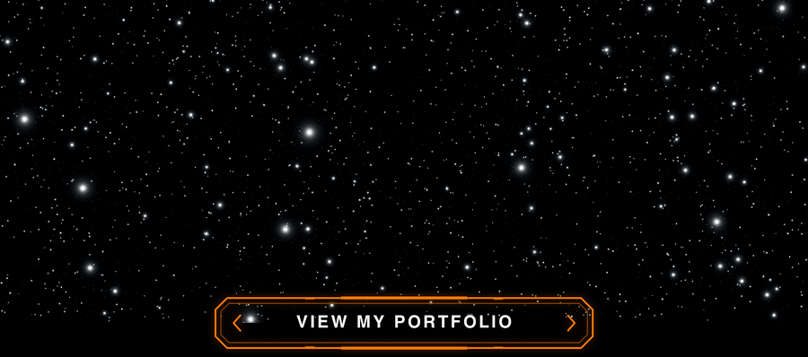
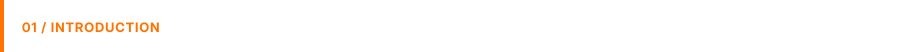
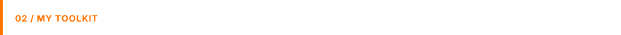
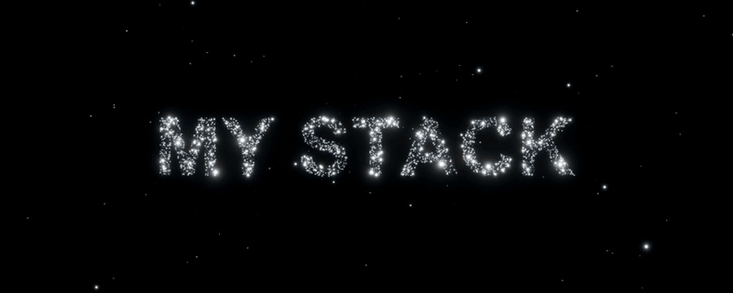
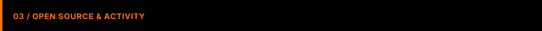
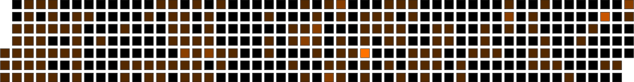
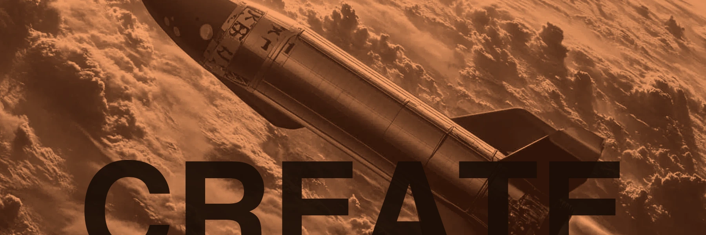

  

## I build software that thinks beyond the ordinary.

**Software Developer | AI/ML Enthusiast | Creative Technologist**

I build practical software across full-stack applications, backend systems and APIs, with a growing focus on artificial intelligence, machine learning, data science and computer vision. I care about the work between an idea and a dependable system: clear interfaces, useful data, thoughtful infrastructure and room to keep learning.

Zambia-based. Open to remote collaboration. Drawn to useful ideas and the engineering it takes to make them real.

 

<picture><source media="(prefers-color-scheme: dark)" srcset="assets/sections/my-stack-dark.gif" /></picture>

 

 

<table width="100%">
<tr>
<td width="50%" valign="middle">

# Let's Build Something *Amazing*

</td>
<td width="50%" valign="middle">

**EXPLORE MY WORK** 
 
 

**SOCIAL** 
  

</td>
</tr>
</table>

<table width="100%">
<tr>
<td align="left">© Amos Kanyanta 2026</td>
<td align="right">Created by </td>
</tr>
</table>

